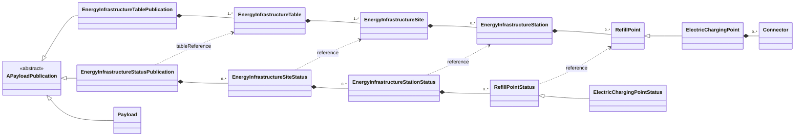
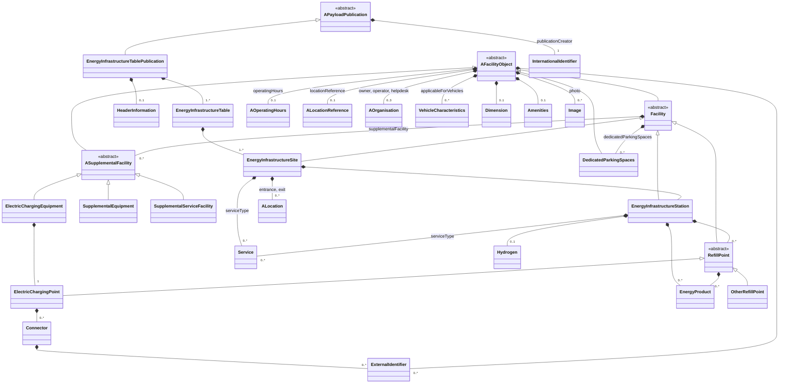
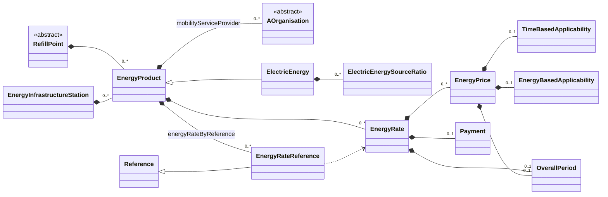
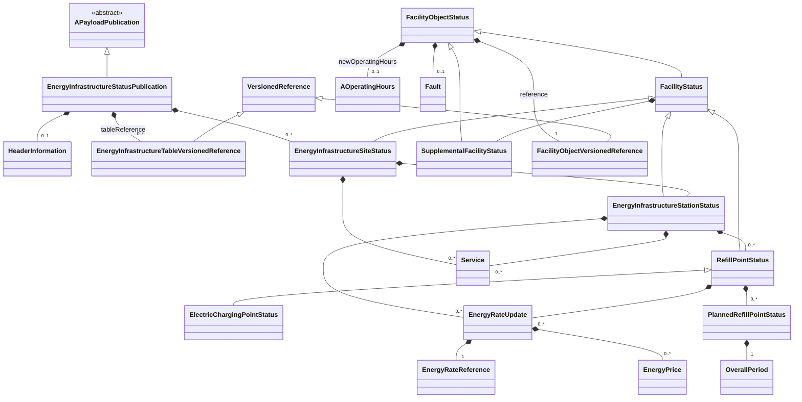
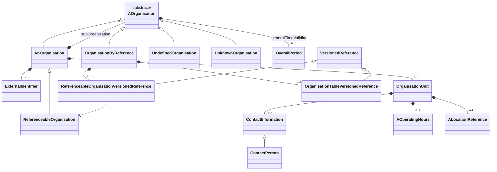
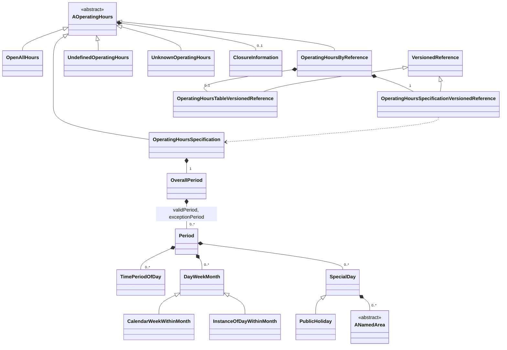
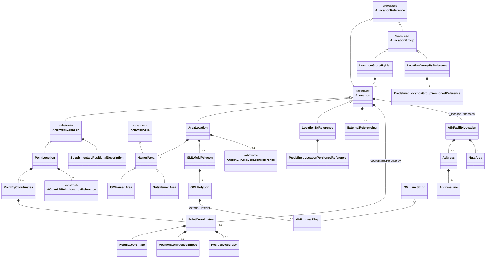
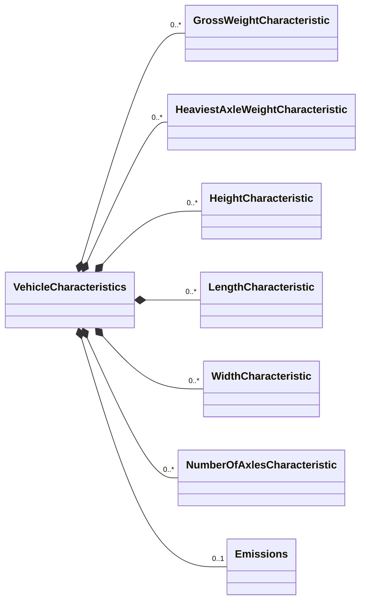
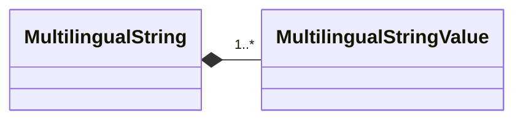

# The WWCP Datex II data model

How the classes in `WWCP_DatexII/DataStructures` belong together. They follow the DATEX II 3.7 schemas; where they come from and how changes are taken over is told in the [README](README.md#where-the-data-model-comes-from).

The diagrams show inheritance and containment, not the simple properties. A name with a leading `A` and the stereotype `abstract` is an abstract class of the schemas; a multiplicity is that of the schema.

| Folder | DATEX II namespace | Prefix |
|---|---|---|
| `EnergyInfrastructure` | `http://datex2.eu/schema/3/afirEnergyInfrastructure` | `aegi` |
| `Facilities` | `http://datex2.eu/schema/3/afirFacilities` | `afac` |
| `Common` | `http://datex2.eu/schema/3/common` | `com` |
| `CommonExtension` | `http://datex2.eu/schema/3/commonExtension` | `comx` |
| `LocationReferencing` | `http://datex2.eu/schema/3/locationReferencing` | `loc` |
| `LocationExtension` | `http://datex2.eu/schema/3/locationExtension` | `locx` |
| `D2Payload` | `http://datex2.eu/schema/3/d2Payload` | `d2` |

Each folder has its classes in `Complex`, its enumerations in `PredefinedStrings` and its value types in `Simple`.

## Overview

AFIR asks for two publications: the **table** with the static data, and the **status** with the dynamic data, which refers to the table by versioned references.

In POI3 terms a site is a charging pool, a station a charging station, an electric charging point an EVSE and a connector a charging connector (see the [POI3 adapter](WWCP_DatexII_Adapter/POI3/README.md)).

## The table publication: sites, stations and refill points

Everything in a table is a facility object: it has a name, external identifiers, operating hours, a location, an owner, an operator and a helpdesk.

A site and a station also name their energy distributor, mobility service providers and roaming platforms, each an `AOrganisation` (see [Organisations](#organisations)).
`OtherRefillPoint` is a refill point that is no electric charging point (`aegi:AlternativeFuelsRefillPoint`, `aegi:DieselRefillPoint` or `aegi:PetrolRefillPoint`): what every refill point has is read, what its type adds is kept and written again as it was read.

## Energy products, rates and prices

What is sold at a refill point or station, and for how much.

## The status publication

The status mirrors the table: a status per site, station and refill point, each naming its object by a `FacilityObjectVersionedReference`.

`FacilityObjectParts`, `FacilityParts`, `FacilityObjectStatusParts` and `FacilityStatusParts` are not DATEX II types: the parsers collect the inherited elements in them before a subclass is built.

## Organisations

Owner, operator, helpdesk, energy distributor, mobility service provider and roaming platform are all of the same kind.

## Operating hours and periods

`OverallPeriod` is also what a service, an energy rate, an energy price and a planned refill point status are valid in.

## Locations

A site, station or charging point is usually a `PointLocation` with its `PointByCoordinates`, and its address, time zone and NUTS areas in the `AfirFacilityLocation` of the location extension. `FacilityLocation` of the location extension is its counterpart for the older `facilities` namespace; the Mobilithek dialect writes an `AfirFacilityLocation` under that name.

## Vehicles

Which vehicles a facility object is for.

The EU vehicle categories are a property of `VehicleCharacteristics` and are written into the regulated characteristics of its common extension. `EmissionsExtension` is the common extension of `Emissions`.

## Texts

Every text a person reads is a `MultilingualString`: one `MultilingualStringValue` per language.

